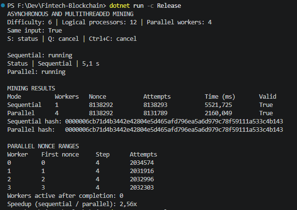
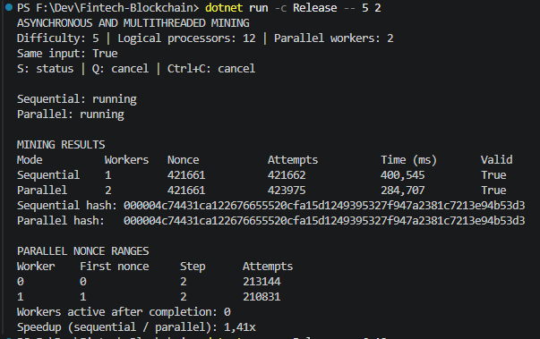
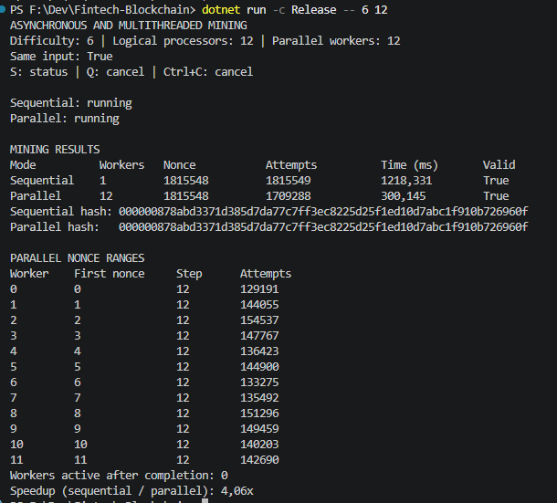

# Асинхронний і багатопотоковий майнінг

| складність | паралельні потоки | звичайний майнінг, мс | багатопотоковий майнінг, мс | прискорення |
| ---------- | ----------------: | --------------------: | --------------------------: | ----------: |
| 6          |                 4 |              5521,725 |                    2160,049 |       2,56× |
| 5          |                 2 |               400,545 |                     284,707 |       1,41× |
| 6          |                12 |              1218,331 |                     300,145 |       4,06× |

за однакових даних і складності всередині кожного запуску багатопотоковий майнінг виконався швидше, прискорення становило від 1,41 до 4,06 раза. порівнювати час між різними запусками напряму не можна, оскільки вхідні дані змінюються через час створення блоку

